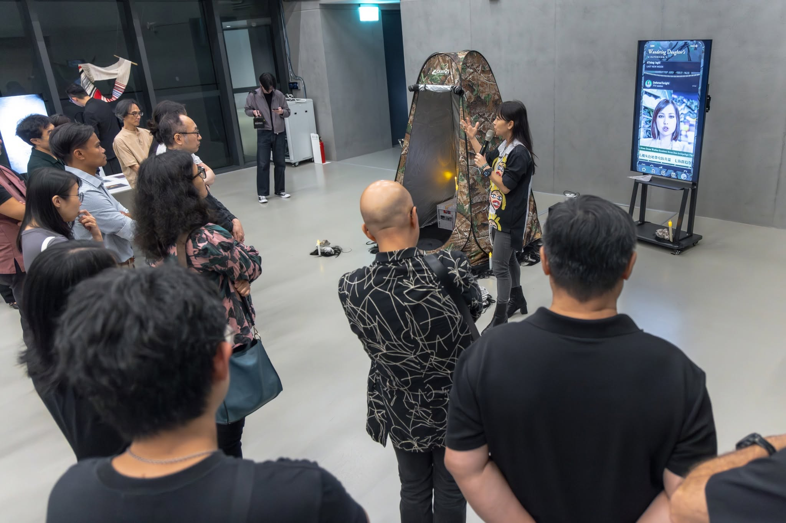
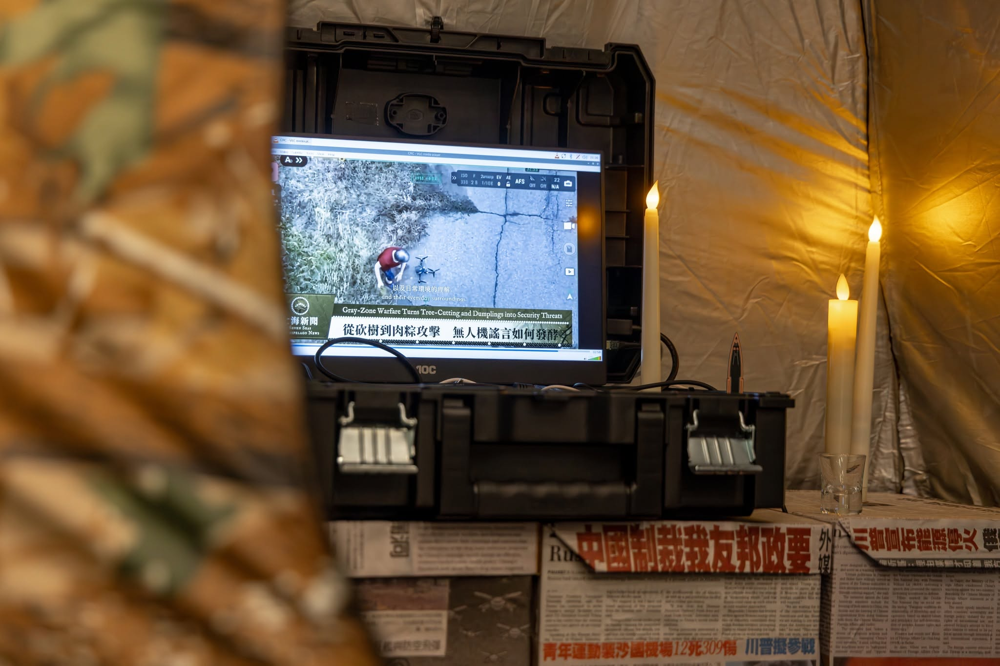

**創作者**｜[李紫彤](/team/tzu-tung/) ＆ [李梅君](/team/meichun/)、[彭宬](/team/cheng/)、[荊輔翔](/team/sean/)、[耿璐](/team/lulu/)、[郭景晏](/team/rosa-kuo/) ([Cyborg Resilience Co-Lab](/))

**時間**｜10/17-10/25
**地點**｜新北市美術館 地下三樓 (B3)

此為「[AI 萬物：起鼓，2026 臺灣嘉年華](https://etat.com/archives/A20261010041312459)」（AI for ALL: Opening Act, Taiwan Festival 2026）特別展示

## 創作背景

無論是無人機群攻、AI 標定系統、認知作戰或網路攻擊，當代衝突已超越物理邊界與人類對道德的認知速度，瀰漫於一個臨界的演算法空間。

這裡，是戰爭的新前線，充斥著資本巨頭分配的 AI 算力與虛假訊息交織而成的瘴氣，在此，勝利者與受害者不再二元對立，而是崩解、塌陷為彼此纏繞、相互利用的共謀。暴力以資訊與代碼 24 小時湧入，如一場緩慢無盡的酷刑。它操弄我們的日常安全感、切割由演算法共構的生存環境、亦展示入侵者的權力。我們的認知空間不斷地被擠壓，退縮到只能等待：等待那個飛彈與子彈落下的處境。

在台灣民間信仰中，「孤娘」是那些未婚、無嗣、無法納入宗祠的女性——父權結構下抹除的存在。為孤娘建祠是將無語、灰色的痛苦，轉化為可被膜拜、具有靈力的外部平衡。《孤娘的無人機藝》以此為隱喻，在生死的中陰、虛實交錯的臨界狀態中開闢路徑，這個計劃透過儀式、藝術創作、民防教育與科技行動，將灰色地帶中無法被言說的痛苦外化、轉化、予以平衡。

我們小組舉辦「非視覺民防工作坊」推回被擠壓的認知空間；「中陰敘事工作坊」則以後人類戰爭為主題的偽敘事搗亂現有戰爭現實、「反監控時尚工作坊」則調查與設計人們如何躲開無人機的辨識.... 每一場藝術實驗、民俗調查、科技行動、聲音搜集，都是試圖重新編織那些，曾被被緩慢暴力瓦解而造就的灰。在 AI for All，我們呈現整體實踐過程中的片段及元素，如同民俗中的水燈撫慰械鬥後的亡靈，孤娘如今陪伴我們面對數位環境中的演算暴力。這些都是我們將數位灰戰中「不可見的權力奇觀」具象並予以抵抗的實踐。

## 現場裝置

### 01｜帳篷

**遮蔽 / 偽裝 / 反偵測**

帳篷不僅是休息與居住的空間，更是防禦無人機偵測的移動遮蔽。它改變人體輪廓，使熱源難以被紅外線感測系統辨識。

### 02｜Meshtastic & 無線電

**分散式網路 / 即時通訊**

戰爭爆發時，基地台與網際網路基礎設施遭破壞，依賴中央機構的通訊方式隨之癱瘓。Meshtastic 作為分散式網路節點，使通訊得以維繫。無線電同樣有效，配合天線可在廣闊範圍內傳遞位置資訊與警示。

### 03｜電腦

**情報 / 協作 / 反擊**

搜尋情報、分析資料、學習無人機反制——電腦也可能成為發動數位攻擊與資訊戰的工具。

## 開展之後：一座姑娘廟，三組裝置
{: #recap}

{: width="2048" height="1366"}

過去幾個月，[CRC 賽伯格韌性實驗室](/)（Cyborg Resilience Co-Lab），研究無人機，討論怎麼躲避監控；我們玩無線電、測試 Meshtastic，想像有一天網路中斷了，人們還能怎麼聯絡彼此；我們也辦工作坊，和不同背景的人一起思考，如果真的遇上戰爭或災難，究竟該怎麼準備？

然後，有一天，這些事情竟然變成了一場藝術展覽。

我們把這些研究、實驗與討論，帶進了新北市美術館，成為《孤娘的無人機藝》（Wandering Daughter’s Dronecraft）。

### 為什麼是「孤娘」？

在台灣民間信仰裡，有些未婚、無嗣的女性，死後無法進入傳統父系家族的祖先祭祀體系。她們成了被遺落在家族秩序之外的存在，卻也可能因為被認為具有靈力，而受到人們祭拜。

我們想從這樣的存在出發，問一個問題：當科技不斷辨識、分類這個世界，當戰爭越來越仰賴無人機與人工智慧，又有哪些人、哪些身體，容易被忽略，甚至被排除在外？於是，這座有點奇特的「姑娘廟」，就這樣在美術館裡出現了。✨✨✨

01｜帳篷 \| 如果天空中的無人機正在看著我們，有沒有可能躲開它的視線？

01｜Meshtastic 與無線電 \| 如果網路斷了，我們還能不能找到彼此？

03｜電腦 \| 在資訊、科技與戰爭交織的世界裡，我們如何取得情報、彼此協作，並找到回應的方式？

它們看起來是三種不同的東西，背後卻有著共同的關心：面對越來越難以預測的未來，我們或許不只是等待事情發生，而是開始學習、實驗，並和身邊的人一起尋找其他可能？

對 CRC 來說，這次展覽也是一個很特別的過程。成員本來只是幾個來自不同領域：藝術 x 學術 x 工程 x 行動，想一起動手做點什麼的人，沒想到最後竟然能把技術、民防、藝術和台灣的民間信仰放在同一個空間裡。

這大概也是我們想像中的韌性：不一定是什麼都準備好了，而是在面對未知的時候，還能找到人一起想辦法。

《＃孤娘的無人機藝》展出中！

展期｜2026.10.17–10.25

地點｜新北市美術館 B3 地下 3 樓交流展示區 (此區不用門票）

本作為「AI 萬物：起鼓，2026 臺灣嘉年華」（AI for ALL: Opening Act, Taiwan Festival 2026）的特別展示之一。如果你剛好來新北市美術館，不妨來看看這座不太一樣的「姑娘廟」。

{: width="2048" height="1366"}

{: width="2048" height="1366"}

照片提供：「AI 萬物：起鼓，2026 臺灣嘉年華」官方攝影：王士源 Shih Yuan Wang
