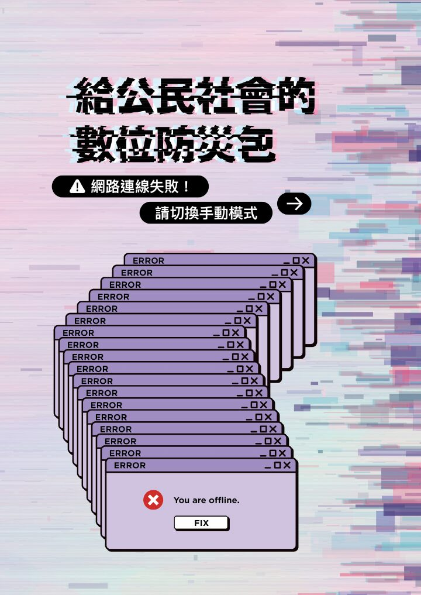

《給公民社會的數位防災包》是 [CRC 賽伯格韌性實驗室](/)寫給公民團體與各種組織的通訊韌性手冊。用 Email 聯絡同事、Google Meet 開線上會議、LINE Pay 結帳付款，網路讓工作更便利，也帶來依賴。萬一哪天網路斷線，我們的工作會不會被迫停擺？

手冊帶團隊一步步盤點任務、優先順位與聯絡步驟，挑出自己能掌握的離線通訊方式，依 PACE 原則（主要、替代、應變、緊急）排好通訊備案並實際測試，最後備妥資料與電力，讓備案在斷網時真的用得上。附錄附有可以直接填寫的盤點表格。

**第一要務：趁現在有網路，將這本手冊下載存起來，或是印出來。** 現在網路不通？翻到第 24 頁〈斷網當下：先做三件事〉，知道自己第一步該做什麼。

{: .item__cover width="720" height="1017"}

## 手冊目錄

- 前言：準備數位防災包，不怕斷網、降速讓你與世隔絕
- 1　建立通訊備案，從斬斷網路依賴開始
- 2　盤點團隊的任務、優先順位與聯絡步驟
- 3　挑出你能掌握的離線通訊方式
- 4　建立團隊的離線通訊方案
- 5　測試團隊的通訊方案
- 6　備妥資料與電力，通訊備案才用得上
- 7　斷網當下：先做三件事
- 附錄：盤點表格

## 作者與合作夥伴

作者：鄭婷宇、[郭景晏](/team/rosa-kuo/)、[彭宬](/team/cheng/)\\
合作夥伴：[弗里德里希諾曼自由基金會台灣辦公室](https://www.freiheit.org/taiwan){: target="_blank" rel="noopener"}、[g0v 台灣零時政府數位韌性松](https://digiresi.g0v.tw/){: target="_blank" rel="noopener"}、歐噴有限公司\\
封面設計與美編：沃草有限公司\\
版本：Version 1.0｜2026 年十二月

手冊於十二月 5 日（六）在 NPO Hub 發表，同場舉辦通訊合作演練：[手冊發表 × 通訊演練](/events/2026-10-28-digital-go-bag-for-civil-society/)。

## 授權與引用

本手冊採 [CC BY-NC 4.0](https://creativecommons.org/licenses/by-nc/4.0/deed.zh-hant){: target="_blank" rel="noopener"} 授權。引用或轉載本手冊內容，請標示：

> 鄭婷宇、郭景晏、彭宬（2026），《給公民社會的數位防災包》，賽伯格韌性實驗室，CC BY-NC 4.0

本手冊提供通訊備援規劃與演練參考，實際可用性仍會受到災害情境、基礎設施、設備、電力及現場條件影響。請依組織需求定期檢視、更新並實際測試備援方案。
